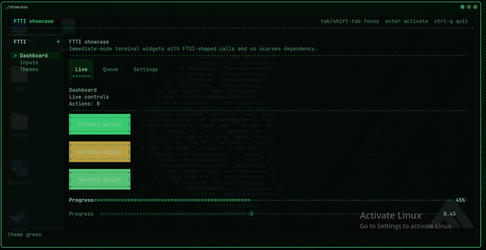
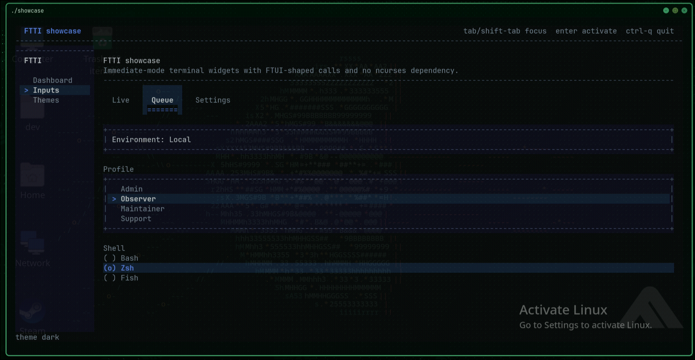
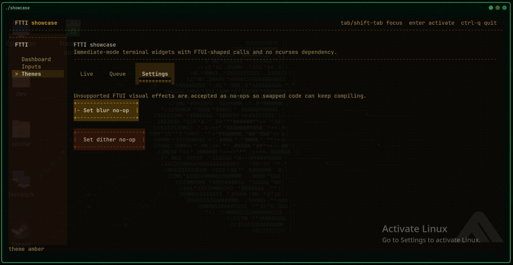

# FTTI

FTTI is **Fuck This Terminal Interface**: a tiny single-header immediate-mode terminal UI for C++.

The goal is ncurses-shaped usefulness without an ncurses dependency, using the same simple coding style as FTUI where the terminal makes that possible.

- Single header: `ftti.hpp`
- Linux/macOS backend: POSIX terminal raw mode + ANSI escape rendering
- Windows backend: Win32 console + virtual terminal output
- No build system required
- WIP widget set: labels, text, buttons, tabs, inputs, text areas, log views, checkboxes, sliders, dropdowns, listboxes, radio groups, collapsible headers, side menus, modals, tooltips, toasts, progress bars, themes, hover detection, and light animation

## Screenshots







## Quick Start

```cpp
#define FTTI_IMPLEMENTATION
#include "ftti.hpp"

int main() {
    ftti::Config cfg;
    cfg.title = "My terminal app";

    if (!ftti::create_window(cfg)) return 1;

    char name[64] = "";

    while (ftti::pump()) {
        ftti::begin();

        ftti::text("Hello");
        ftti::input("Name", name, sizeof(name));

        if (ftti::button("Go")) {
            // handle action
        }

        ftti::end();
    }

    ftti::shutdown();
    return 0;
}
```

## Build

Linux/macOS:

```bash
c++ demo.cpp -std=c++17 -o demo
```

Windows with MSVC:

```bat
cl /std:c++17 demo.cpp
```

## Compatibility With FTUI Syntax

New code should include `ftti.hpp` and use `ftti::`:

```cpp
ftti::button("Run");
```

For copied FTUI snippets, `ftui.hpp` is a compatibility shim:

```cpp
#define FTUI_IMPLEMENTATION
#include "ftui.hpp"

ftui::button("Run");
```

The shim aliases `namespace ftui = ftti;`. It is meant for early porting, not as the final public name.

Unsupported GUI-specific FTUI calls are intentionally tolerated where possible. Window blur, dither backdrops, native icons, image drawing, child windows, and file dialogs either become no-ops or terminal-safe placeholders instead of breaking compilation.

## Current API Surface

Core loop:

```cpp
ftti::create_window();
while (ftti::pump()) {
    ftti::begin();
    // widgets
    ftti::end();
}
ftti::shutdown();
```

Widgets:

```cpp
ftti::label("Status");
ftti::text("Ready");
ftti::text_wrapped("Long text wraps inside the current content area.");
ftti::separator();

if (ftti::button("Run")) {}
if (ftti::button("Deploy", ftti::ColorRole::Accent)) {}

char command[128] = "";
bool submitted = false;
bool enabled = true;
float amount = 0.5f;
ftti::input("Command", command, sizeof(command), ftti::InputFlags::Default, &submitted);
ftti::text_area("Notes", command, sizeof(command), 5);
ftti::log_view("Output", "[00:00] Ready\n", 6);
ftti::checkbox("Enabled", &enabled);
ftti::slider_float("Amount", &amount, 0.0f, 1.0f);

const char* tabs[] = {"Run", "Logs", "Settings"};
int tab = 0;
ftti::tabs(tabs, 3, &tab);

if (tab == 0) {
    ftti::text("Run panel");
} else if (tab == 1) {
    ftti::text("Logs panel");
} else {
    ftti::text("Settings panel");
}

const char* envs[] = {"Local", "Staging", "Production"};
int env = 0;
ftti::dropdown("Environment", envs, 3, &env);
ftti::listbox("Environment", envs, 3, &env);
ftti::radio_group("Environment", envs, 3, &env);

const char* menu[] = {"Overview", "Input", "Themes"};
int section = 0;
ftti::side_menu("FTTI", menu, 3, &section);

if (ftti::collapsing_header("Advanced")) {
    ftti::progress_bar(0.75f, "Progress");
}
```

Themes:

```cpp
ftti::set_style(ftti::default_dark_style());
ftti::set_style(ftti::light_style());
ftti::set_style(ftti::terminal_green_style());
ftti::set_style(ftti::midnight_style());
ftti::set_style(ftti::amber_style());
```

FTUI theme names also exist where practical:

```cpp
ftti::set_style(ftti::catppuccin_mocha_style());
ftti::set_style(ftti::nord_style());
ftti::set_style(ftti::gruvbox_dark_style());
ftti::set_style(ftti::one_dark_style());
ftti::set_style(ftti::ghostty_green_style());
```

## Input

- `Tab` / `Shift+Tab`: move focus
- `Enter`: activate focused button, submit focused input, or advance focused tabs/dropdowns
- Arrow keys: navigate focused tabs, side menus, sliders, listboxes, radio groups, and logs
- `Ctrl+Q`: quit by default
- Mouse click, hover, and wheel support are enabled on ANSI terminals that report SGR mouse events
- Sliders only change from keyboard arrows or mouse press/drag on the slider rail; hover only lights them up

Tooltips attach to the last item and float near the focused or hovered widget after a short steady-hover delay:

```cpp
ftti::button("Run");
ftti::tooltip("Runs the selected task.");
```

Vim-style commands:

- `:` opens the command line
- `Esc` cancels it
- `Enter` runs it
- `q`, `quit`: quit
- `theme dark`, `theme light`, `theme green`, `theme amber`: switch themes
- `tab next`, `tab prev`: move the active tab bar
- `help`: show command help

## Kitty Images

`load_image()` / `image()` emit Kitty graphics protocol local-file commands when possible and draw a terminal placeholder frame as a fallback:

```cpp
ftti::ImageHandle* img = ftti::load_image("screenshot.png");
ftti::image(img, 32, 10);
ftti::free_image(img);
```

This uses Kitty's local-file transmission path, so the terminal must be able to read the image path.

## Build Targets

```bash
make clean all
```

This builds:

- `build/demo`
- `build/showcase`
- `build/minimal`
- `build/compat_ftui`

## Repository Layout

- `ftti.hpp`: single-header library
- `ftui.hpp`: temporary compatibility shim for old FTUI-style includes
- `demo.cpp`: root demo entrypoint
- `examples/showcase.cpp`: broader WIP widget tour
- `examples/minimal.cpp`: smallest complete app
- `examples/compat_ftui.cpp`: smoke test for the `ftui.hpp` compatibility include
- `Makefile`: optional local smoke build

## Status

This is intentionally early. The backend is terminal-native, not a GUI port. Layout helpers like `row()`, `split()`, `scroll_area()`, and `set_next_width()` exist for FTUI-style call compatibility, and more FTUI calls should keep getting synced until swapped-in apps compile cleanly.
